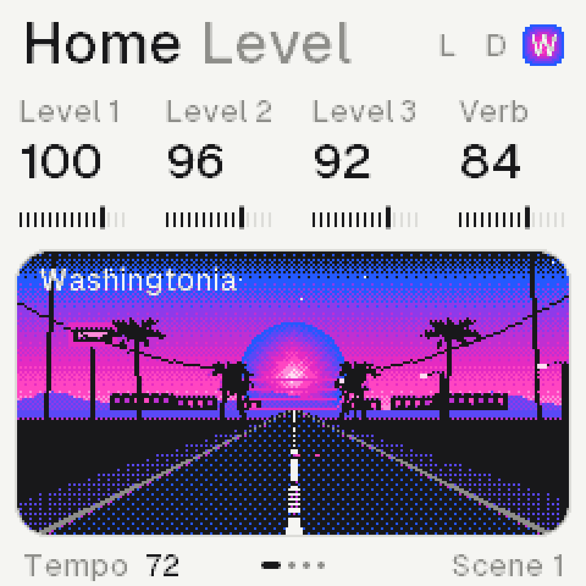

# Demake synth

An ambient lofi machine for the M-VAVE FM-1, built on its own recordings: 64 sounds made with pedals and kept as
they were, played by three synths. Each synth has its own piano roll, its own patterns and a chain of lofi effects.
Scenes combine the synths' patterns, a song arranges the scenes, and a chord machine leads them all. It is voiced
like a late-90s console demake, and drawn in Geist with Kiloy's shapes: four greys, cards, and one thermal light,
dithered, for what is lit.

- **Play it in the browser:** [inigohernandez.github.io/demake-synth](https://inigohernandez.github.io/demake-synth/)
  (the same core as the firmware).
- **Install it:** [the installer page](https://inigohernandez.github.io/demake-synth/install.html), over USB from
  Chrome.
- **Read the manual:** [the manual](https://inigohernandez.github.io/demake-synth/manual.html).

**Status: Demake 0.4.11** (FM-1_969), on the install page.

## What it does

- **The sound.**
  - The 64 recordings are built in, like a rompler, with nothing to load.
  - A filter with eight shapes and a drive, an envelope, and an LFO on the pitch, cutoff, level, pan or start, free
    or on the tempo.
  - A layer: a second recording under a sound. Glide, velocity, the cutoff following the key, and grit (the voice at
    22 or 11 kHz).
  - Per synth: Colour (saturate, crush, codec, noise, warm, distort), a Delay in time (delay or ping-pong) and
    Motion (chorus, vibrato, drift, ensemble, phaser, flanger, tremolo).
  - Shared: eleven reverbs (room, hall, space, haze, bloom, lofi, plate, spring, shimmer, reverse, freeze), a tape
    echo or grains, and Media over the whole mix (tape, cassette, VHS, vinyl, radio, dictaphone); each can be off.
- **The music.**
  - Three synths, each with a piano roll of up to 64 steps and eight patterns of its own.
  - Sixteen scenes say which pattern each synth plays, and switch on the bar with HOME held and a white key.
  - A song arranges the scenes, up to 128 steps of 1 to 8 bars, typed in or recorded live.
- **The harmony.**
  - A chord machine with sixteen progressions and four of your own, voicings, strum and rhythms.
  - The keys play chords on any page: sevenths, triads, ninths, add9, sus2, sus4, 6/9 or power; on the roll they
    write them.
  - Each synth can play the chords, follow the key, the chord or the root, or harmonize another synth's notes.
- **The rest.**
  - MIDI in and out over USB (and in on the TRS jack): notes by synth channel, the clock in or out.
  - Fourteen songs and 32 of your own sounds are saved on the FM-1.
  - Each start shows one of thirteen pixel landscapes (peaks, a lake, a beach at sunset, the night, a city from a bedroom, a
    2000s desk, spruces in a blue fog after sunset, a living room with a CRT and a VHS deck, a pool house by the sea, a
    street of palms in California, a harbour in fog, a lighthouse on a cliff, a city skyline at night), and Home keeps
    one moving while you play; OCT− and OCT+ held show it full screen.
  - Each sound is named after a plant, in Latin, one word.



## On the FM-1

- **What it is to the FM-1.** Identity `FM-1_969`, the same for every release; over USB a MIDI device named
  "Demake FM-1" (its update loader, Felucca's, shows as "Felucca Update"). It carries Felucca's update loader.
- **What it keeps.** Its own store: 64 KiB of the FM-1's data area, `0xB0000`–`0xC0000`, holding up to 14 songs and
  32 of your sounds. Installing Demake writes only its program, never the data area. Demake writes there only when
  you save (a song, a sound, or a song erased), a 4 KiB sector at a time, and reads only its own records (each has
  its mark and a checksum): it never loads another firmware's projects or samples. Other firmwares keep things in
  the same region (Felucca's samples, CoralFlower's loops), so a Demake save can overwrite what they kept there,
  and they can overwrite Demake's songs. MONO2K's store (`0xC0000`–`0xE0000`) is left alone.
- **Back it up.** There is no backup tool for Demake yet: its songs and sounds live only on the FM-1. Before you
  switch to a firmware that saves into `0xB0000`–`0xC0000`, expect Demake's songs to be lost.
- **Leave it.** Install another firmware as usual (the FM-1 Firmware Hub, or its maker's installer): Demake takes
  the package over USB and starts the new package's update loader.
- **Rescue.** Hold OCT− while switching on: the FM-1 starts the update loader only and waits for a package over USB.
  The [installer page](https://inigohernandez.github.io/demake-synth/install.html) works from there.

## Build

```bash
sh tools/check.sh                              # warnings, soft-float symbols, sanitizers, the self-test and the tour's text audit, wasm
sh web/build.sh                                # web/dmk.wasm; serve web/ to play it in the browser
.venv/bin/python tools/fm1/build.py            # build/fm1/demake.fwsc; --release X.Y[.Z] (FM-1_969 always), --diag (the load meter), --bench
```

The core is C99 and integer only (`firmware/src`, a unity build). The host harness (`host/dmk_host.c`) runs the
self-test, renders every screen as a PNG and counts the CPU. The plans:
- [docs/plan.md](docs/plan.md): the whole design and every decision;
- [docs/sound-design.md](docs/sound-design.md): the next stages for the sound and the song.

It runs on the open FM-1 platform of CS-1 and Felucca, as MONO2K does, so it is GPL-3.0-only (see
[LICENSE](LICENSE)). The notices of every source it uses are in `LICENSES/` and `firmware/fm1/LICENSES/`. The
recordings are the author's own.

By Sequencist ([GitHub](https://github.com/InigoHernandez), [Bandcamp](https://sequencist.bandcamp.com),
[Ko-fi](https://ko-fi.com/sequencist)).
