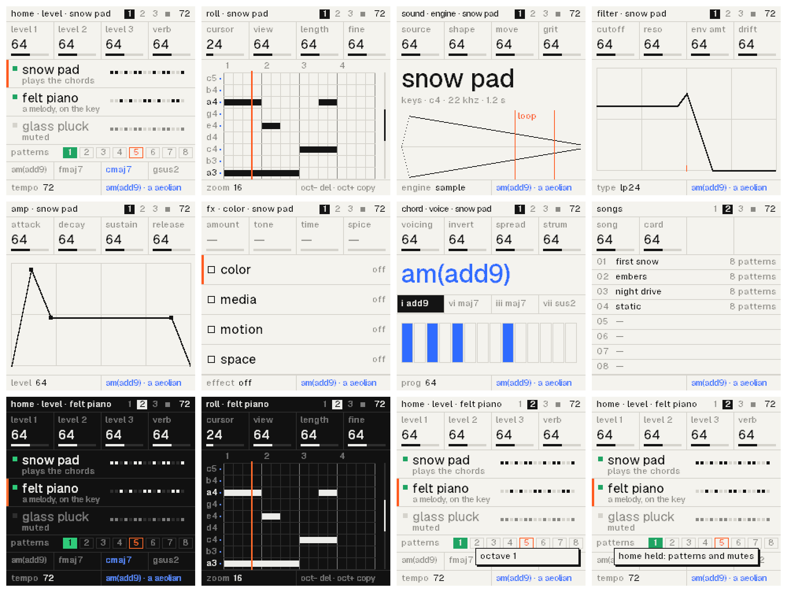

# Demake synth: the plan

A lofi ambient synth firmware for the M-VAVE FM-1, melancholic, with a late-90s console demake look and sound.
Written 2026-10-23, before any code. Every number below is marked **[M]** (measured) or **[E]** (estimated); the
measurements are Mac instruction counts with the FM-1's build flags (1.1), taken from MONO2K's code and from
throwaway integer prototypes of each kernel.

## 0. In one page

- **Three synths**, each with an engine (SAMPLE, PAD, DRONE, PLUCK), a second **layer from the owner's samples**,
  its own sequence in a **piano roll**, and a chain: COLOR → MEDIA → MOTION → SPACE. Two **shared send buses**
  (ECHO, VERB) take every reverb and delay. **12 voices** are shared by the three.
- **8 patterns a song**, each holding the three sequences and a chord progression; sounds and effects stay the
  same across patterns, so switching is seamless. Switch with HOME held and a key, queued to the bar: two presses.
- **A chord machine** (key, mode, 16 melancholic presets, voicing, inversion, spread, strum) drives a synth, and the
  other synths' notes follow its chords.
- **Playful first:** nearly every task in one or two presses (the few exceptions are flagged in 3.7). Keys write
  where the cursor is, a held key is the note you edit, OCT− takes away, OCT+ copies, and everything undoes.
- **The look:** one system for the screen, the emulator and the website (5.1): Geist in sentence case, Kiloy only in
  the wordmark and its D (the isotype); a monotone UI in the screen's four greys and one thermal light for what is
  lit (a blue rim, a magenta body, a pale core, read from each shape's depth, dithered: the bit texture); cards with
  Kiloy's corners, a two-line title (ink, then grey), big numerals, tick meters.
- **The website** (section 6): a canvas of 48 px modules after a node canvas's graph paper, every edge on its lines;
  the device as the product shot; cards and images of mixed proportions; graphics after Kiloy's specimens.
- **The sound:** the owner's 64 recordings as 4-bit block ADPCM at 11–22 kHz, a per-synth GRIT (22 kHz, ADPCM),
  and reverbs voiced by ear after console rooms, halls and space echoes.
- **It fits.** The yardstick is 1650 instructions a core (1.1); Hortator's device calibration puts a core at ~3470.
  - Every effect on every synth at once: 82 % of the yardstick on each of the two cores.
  - Typical effects with a sample layer on every voice: 95 % (1.4).

**Decided by the owner:** the design of 5.1 and 6 (it replaced, in turn, Tomato Grotesk and a late-90s desktop,
an all-lowercase Geist table in eight state colours, a rainbow holographic field and a heat ramp swept across the
screen); 12 shared voices; three synths with patterns for performance.

**Still the owner's decisions** (each is also in its section):

1. **Where saves and extra samples live** (2.6): I suggest keeping MONO2K's store (`0xC0000..0xE0000`) untouched,
   so both firmwares keep their saves.
2. **The identity range** (2.7): `FM-1_965` (tests) and `966`+ (releases) look free.
3. **The samples' licence** (2.5): your recordings ship in the package. The code is GPL-3.0; the sounds could be
   GPL-3.0 too, or CC BY 4.0 if you want others to reuse them.
4. **Additions to the brief, to keep or drop:** a SOUND page with its LAYER row (EDIT), a HOME page (the synths,
   mixer, performance layer), an LFO page (later), DRIFT as FILTER's fourth knob.
5. **Integer only, as the brief says, though the chip has an FPU.** AMB-1, FoMni, FiMba and FuMi compile their DSP
   in single-precision float with the SDK's `-mcpu=r3 -mfprev1`; MONO2K, CS-1, OberVave and Clipper forbid float.
   This plan stays integer: it keeps MONO2K's tooling, the browser and host renders identical to the device's, and
   the platform's build checks. Phase 0 can time the FPU in ten minutes, for the record.

## 1. The effects

### 1.1 Budget and method

- **Counting.** Mac instructions per 44.1 kHz output sample (per stereo frame for stereo kernels), built as the FM-1
  builds (`cc -O2 -fno-builtin -fno-vectorize -fno-slp-vectorize`), read from `proc_pid_rusage` `ri_instructions`,
  median of 3 runs of 10 s. Felucca's yardstick (its heaviest mix, 1574 with plain `-O2`) is ~1650 in this stricter
  count (MONO2K's ratio, ×1.05).
- **Capacity per core.** The yardstick, 1650, is proven to run on one core. Hortator's on-device calibration (6.86 ns
  a host instruction, heavy DSP within ±8 %) puts 100 % of a core at ~3470; with 20 % kept back for the screen and the
  panel, that is ~2750 a core [E]. MONO2K's busiest pattern (a 2714 critical path over two cores [M]) "runs without
  overload" on the FM-1. Clipper's tests use "1.7 % per 100 host instructions", which would put a core at ~5900:
  the calibrations disagree, and no firmware has measured the clock (claims range from 240 to 360 MHz). **This plan
  budgets against the yardstick** and treats the rest as headroom until phase 0 measures the ratio on the device.
- **The JieLi compiler's code** for the kernels was checked against the Mac's: its inner loops are 0.9–1.5× as long,
  median ~1.2. Delay lines with many wrap tests and 64-bit state run ~1.4×, plain filters ~1.0× [M, static]. Kernels
  with delay lines get extra margin.
- **Rates.** Per-synth effects run at 44.1 kHz. The buses run at 22.05 kHz: lofi by nature, half the memory, and
  the halving and doubling (a half-band each way) is ~31 a sample in stereo, included in every bus figure.
- **Sources.** pichenettes/eurorack (MIT) and electro-smith/DaisySP (MIT, `Source/`) do all their arithmetic in
  float, even where their delay buffers are 12- or 16-bit, so they are **algorithm references**, ported to Q15 / Q31
  by hand. hugelton/Felucca (GPL-3.0, integer, runs on this chip) and Felucca-Engines (MIT, integer) are the code
  references. MONO2K's code is the owner's own (GPL-3.0). Paths: ER = `eurorack/`, DS = `DaisySP/Source/`,
  FEL = `Felucca/firmware/src/`, FE = `Felucca-Engines/src/`, M2K = `mono2k/firmware/src/`.

### 1.2 Per synth: COLOR, MEDIA, MOTION, SPACE

One effect per row and per synth, picked with ALGORITHM, OFF first. Macro slots: K1 AMOUNT, K2 TONE, K3 TIME,
K4 CHARACTER (3.4).

| Row | Effect | Algorithm | Source | RAM / synth | Instr / sample |
| --- | --- | --- | --- | --- | --- |
| COLOR | SATURATE | tanh from a 257-entry table, interpolated; a bias for even harmonics; tilt EQ before and after (two one-poles). AMOUNT drive, TONE tilt, CHARACTER even ↔ odd | FE `dsp.c` `softclip()` + `TANH_Q15`; the bias after FEL `fx.c` `track_dist()` | 16 B | 18 [M] + 14 = **32** [E] |
| COLOR | DISTORT | drive 1–9× into a clip that morphs into a triangle fold, a 2-pole tone low-pass, make-up gain. AMOUNT drive, TONE low-pass, CHARACTER clip → fold | FEL `fx.c` `ins_drive()` / `ins_shape()`; M2K `fold16()` | 24 B | 18 + 14 + 22 = **54** [E] |
| COLOR | CRUSH | bit depth by rounding (no DC), sample-and-hold on a fractional Q16 clock, an SVF low-pass in front. AMOUNT bits 16 → 3, TONE anti-alias, TIME rate 44.1 → 1 kHz, CHARACTER clock jitter | ER `braids/braids.cc` bit masks and decimation; FEL `INS_HOLD`; FE `tsvf_lp` | 32 B | 9.5 [M] + 22 = **32** [E] |
| COLOR | CODEC | **own design**, MP3-style smear: a 4-band SVF crossover at 22.05 kHz; per frame each band's quantizer step from the frame's peak; weak high bands gated (holes, "birdies"); the step applied through a look-ahead so noise smears before transients (pre-echo). AMOUNT loss, TONE band limit (to 4 kHz), TIME frame 64–512 samples, CHARACTER dropouts and warble (random band and frame gating). If it doesn't sound codec enough: a 64-point integer MDCT instead | own; no codec effect exists in any of the repos | 0.8 KB | 4-band **101** [M]; MDCT M = 32 **139** [M] |
| COLOR | NOISE | hiss (xorshift, one-pole colour), crackle (random clicks from a probability table, sign alternating, ×5/8 decay), hum (50 / 60 Hz, harmonics 1–5 from the sine table, slowly wandering). AMOUNT hiss, TONE colour, TIME crackle density, CHARACTER hum. Sounds while the synth or its tail does | M2K `m2k_fx.c` `bus_block()` hiss and crackle; FE `eng_noise.c`; hum own | 20 B | **60** [M] |
| MEDIA | TAPE | a modulated delay (wow 0.3–1 Hz with a slowly random rate, flutter 5–7 Hz; Q16 linear read), a head-bump biquad (60–120 Hz, +2–4 dB), soft-clip saturation, head-loss one-pole. AMOUNT saturation, TONE bump and HF, TIME wow, CHARACTER flutter | M2K `bus_block()` tape; ER `beads/dsp/fx/wow_and_flutter.h` (the random-rate wow); FE `softclip()` | 4.2 KB | **74** [M] (×1.4 on the target: a delay line) |
| MEDIA | CASSETTE | TAPE's line with a faster, random warble; HF loss as a 2-pole low-pass at 6–10 kHz that closes as the level rises; dropouts: random 10–150 ms dips of 3–20 dB that close the low-pass further. AMOUNT warble depth, TONE HF loss, TIME warble rate, CHARACTER dropouts | own, on TAPE's parts | 4.2 KB | **~88** [E] |
| MEDIA | VHS | band limit 80 Hz–10 kHz, a slow deep wobble with fast jitter, a head-switch tick at 25 / 29.97 Hz, "tracking" events (20–200 ms: a mute or noise burst, a pitch dip, a short repeat from the line). AMOUNT wobble depth, TONE band limit, TIME wobble rate, CHARACTER tracking glitches | own, on TAPE's parts | 8.3 KB (repeats up to 93 ms) | **~95** [E] |
| MOTION | CHORUS | 2 swept taps (quadrature LFOs) at 7–20 ms, stereo out; CHARACTER 1 tap mono → 2 taps → a 3-tap ensemble with a fast and a slow LFO. AMOUNT depth and mix, TONE wet low-pass, TIME rate, CHARACTER voices and width | ER `rings/dsp/fx/chorus.h`, `ensemble.h` (topology); FEL `fx.c` chorus; M2K `mod_tick()` | 2.1 KB | 2 taps **53** [M]; ensemble ~75 [E] |
| MOTION | VIBRATO | pitch modulation of the synth's voices at control rate (no delay line): a sine at 3–8 Hz. AMOUNT depth, TIME rate, CHARACTER fade-in | own | — | **~2 a voice** [E] |
| MOTION | DRIFT | each voice its own smoothed random pitch wander, and a random detune per note. AMOUNT wander depth, TIME wander rate, CHARACTER per-note detune | ER `braids/vco_jitter_source.h` (MIT, integer); FE drift | 8 B / voice | **~2 a voice** [E] |
| SPACE | the sends | VERB SEND, ECHO SEND, PAN, WIDTH (alternate voices spread left and right) | — | — | **5** [E] |

VIBRATO and DRIFT act on the voices rather than on a delay line: cheaper, cleaner, and each voice can drift its own
way. They still sit in the MOTION row, where the brief puts them.

### 1.3 Shared: the ECHO and VERB buses

Every synth sends to both; each bus holds one type at a time (GLO, 3.4), stereo, at 22.05 kHz.

| Bus | Type | Algorithm | Source | RAM | Instr / sample |
| --- | --- | --- | --- | --- | --- |
| ECHO | TAPE | 8-bit mu-law lines (1.5 s), wow on the read; a time longer than the line slows the line's clock instead (darker, like tape); one-pole HP and LP and a soft clip in the loop. AMOUNT return, TONE loop filter, TIME synced 1/16 … 1/2 dotted or free, CHARACTER feedback | M2K `m2k_fx.c` `delay_block()`, `mulaw_enc()`, `dl_read()`; ER `clouds/dsp/mu_law.h` (MIT alternative) | 66 KB | **65** [M] |
| ECHO | PING-PONG | sum and difference lines, so each repeat crosses sides | M2K `delay_block()` dual mode | (shared) | **65** [M] |
| ECHO | FILTERED | a band-pass in the loop: TONE its centre, CHARACTER feedback and width | M2K's loop filters | (shared) | **~70** [E] |
| VERB | ROOM | **own voicing** after console rooms, by ear: MONO2K's SPU-style comb and all-pass network with our own tap lengths and gains, ~0.25 s of lines. (The console's documented preset registers are not used.) AMOUNT return, TONE damping, TIME size, CHARACTER early reflections | M2K `bus_block()` reverb; FEL `fx.c` `rev_room()` (Freeverb-style) | 7–11 KB | **72–90** [M] |
| VERB | HALL | 8-line FDN with a Hadamard (adds only) matrix, input diffusers, damped and swept lines, ~1.5 s; voiced after console halls. CHARACTER modulation | FEL `fx.c` `rev_hall()`; DaisySP-LGPL `ReverbSc` (float, LGPL) as a reference | 66 KB | **216** [M] |
| VERB | SPACE | ROOM's network with long discrete echo taps spread over ~1.4 s, voiced after a console's space echo. CHARACTER echo density | own, on ROOM | (in the 66 KB) | **~110** [E] |
| VERB | PLATE | Dattorro / Griesinger: 4 input all-passes, a figure-8 tank of two halves with LP damping and slow-modulated all-passes, ~1 s of lines. CHARACTER modulation | ER `clouds/dsp/fx/reverb.h` (topology; Q15 accumulators) | 45 KB | **244** [M] |
| VERB | SPRING | 2 springs, each 12 stretched all-passes (a + z⁻²) / (1 + a·z⁻²) for the chirp, a 30–60 ms loop with LP and decay, pickups with a slow wobble. CHARACTER drip | FEL `fx.c` `rev_spring()` (after Välimäki, Parker and Abel) | 4.6 KB | **156** [M] |
| VERB | SHIMMER | PLATE with a 2-tap, crossfaded +12 semitone pitch shifter in its loop (LP and gain under 1). CHARACTER shimmer amount | ER `clouds/dsp/fx/pitch_shifter.h` (topology); FEL `perform.c` `perf_harm()` | 49 KB | **279** [M] |

The VERB types share one 66 KB buffer (switching type clears it); the ECHO has its own 66 KB.

### 1.4 What fits

Voices come from section 2: ~110 instructions a voice at 44.1 kHz [E from M parts], and ~65 more when the sound's
LAYER is on (a second ADPCM sample read). The three columns:

- **Lean:** SATURATE on each synth, ROOM.
- **Typical:** SATURATE or CRUSH, TAPE and CHORUS on every synth; PLATE and the ECHO.
- **Heavy:** CODEC, VHS and the ensemble on every synth; SHIMMER and the ECHO.

All 12 voices are counted as sounding.

| Part | Lean | Typical | Heavy |
| --- | --- | --- | --- |
| base: sequencer, mix, control-rate work, master limiter | 150 [E] | 150 | 150 |
| 3 synth chains (each: COLOR + MEDIA + MOTION + sends + 25 overhead) | 3 × 63 = 189 | 3 × 189 = 567 | 3 × 301 = 903 |
| buses | ROOM 90 | ECHO 65 + PLATE 244 = 309 | ECHO 65 + SHIMMER 279 = 344 |
| 12 voices × 110 | 1320 | 1320 | 1320 |
| **total** | **1749** | **2346** | **2717** |
| per core, buses on core 2 | ~875 | ~1175 | ~1360 |
| against the yardstick (1650) / the calibrated plan (2750) | 53 % / 32 % | 71 % / 43 % | 82 % / 49 % |
| **with a LAYER on every voice** (+12 × 65 = 780) | 77 % / 46 % | 95 % / 57 % | **106 %** / 64 % |

So, measured against the yardstick:

- **Every reverb, the shimmer and the echo must be shared buses.** One stereo 1.5 s echo is 66 KB, so one per synth
  would take most of the 336 KB pool. The reverbs cost 72–279 instructions and 5–66 KB each.
- **COLOR, MEDIA and MOTION stay per synth.** Each costs 32–101; the per-synth lines total 2–8 KB.
- **Every effect on every synth at once fits** (82 %).
- **So does a sample LAYER on every voice with typical effects** (95 %).
- **Only heavy effects with a LAYER on all 12 voices passes the yardstick.** Four things keep it safe:
  - the voice pool sheds voices under load, oldest released first, and the window nudges with LOAD (as Hortator
    sheds above 95 %);
  - GRIT 22K halves a synth's voice cost (2.3);
  - if the device's ratio is as Hortator measured, it fits anyway (64 % of the plan);
  - the MDCT version of CODEC (139) is only used if the 4-band one (101) does not sound right.
- **Three synths instead of four** pay for this. A fourth chain and four more voices would cost ~630; that is
  instead spent on every effect running everywhere, and on the layers.
- **The two cores:** each 16-sample block the first core hands synths [split, 3) to the second, balanced by cost.
  The buses run on the second core one block late (0.36 ms), which takes them off the first core's critical path
  (MONO2K runs its bus after the join; Demake doesn't need to). The second core's job runs from XIP flash and its
  loop from RAM (CS-1's audio worker): the first core joins it before any flash write (2.6).

## 2. Engines and samples

### 2.1 The engines

Any synth can play any engine; a synth's voices all use its engine. Per voice: the engine, a ZDF SVF (TYPE LP12,
LP24, BP, HP, OFF; 27 [M] with coefficients every 16 samples) and the ADSR (7.5 [M]).

| Engine | What it is | Built from | Instr / voice |
| --- | --- | --- | --- |
| SAMPLE | a sample from flash, 4-bit block ADPCM decoded on the fly (2.4), pitched by a Q16 phase with linear interpolation; START trims the attack (by blocks); LOOP OFF, FULL (the sample's loop), or SHORT 1/2 … 1/16: a shorter loop inside the sustain, for the short-sample, looped-pad character | the decoder ours, from the format's public description; the player after FEL `eng_sample.c` (IMA ADPCM streamed from flash) | ADPCM voice 62–79 [M] + 35 = **~105** |
| PAD | 3 wavetable oscillators on the owner's single cycles (32 of MONO2K's 64, band-limited twice), detuned around the note; MORPH crossfades to the next wave and back, slowly | M2K DIGI-WAV and SWAV-ENS (the owner's own) | 3 × 24 [M] + 10 + 35 = **~117** |
| DRONE | 4 partials per voice (the COLOR set: root, fifth, octave, ninth …), each pair beating (BEAT, 0–8 Hz), each partial's level wandering on its own smoothed random (EVOLVE), a little breath noise; a long note never repeats itself | own design; sines from the table | 4 × 10 [M] + 20 + 35 = **~95** |
| PLUCK | Karplus-Strong: a noise or sample burst into a delay line with a damping loop filter (TONE, DECAY); BODY blends in two resonant modes for kalimba, glass and bell | FEL `phys_dsp.c` (MIT port of DaisySP / Plaits' string and modal, integer; its per-note 64/32 divisions become a reciprocal and a Newton step); ER `braids` `RenderPlucked` (MIT, integer) | **~100** [E] |

**LAYER: more from the owner's samples.** Every sound can add one of the owner's samples under its engine, read by
the same voice. Some examples: a breath of bansuri over a PAD, a felt-piano attack over a DRONE, a pad's tape wash
under a PLUCK.
- **Where:** SOUND's second row (tap EDIT again).
- **Controls:** ALGORITHM picks the sample (OFF first). K1 BLEND (layer against engine), K2 TUNE (−24 … +24
  semitones; octaves and fifths first), K3 LOOP (OFF · FULL · SHORT), K4 TONE (its own one-pole low-pass).
- **Signal:** it goes through the voice's filter and envelope with the engine.
- **Cost:** ~65 a voice while on [E from the ADPCM voice kernel, M].

This is where the three-synth budget goes: the 64-sample library becomes a palette of textures under every engine.

### 2.2 Voices and the two cores

- A pool of **12 voices** shared by the three synths. Each synth has a POLY of 1–8: the chord synth 6, the others
  3 by default.
- A new note takes a free voice, else the synth's oldest released voice, else its oldest.
- The budget (1.4) holds 12 voices with every effect, or with typical effects and a LAYER on each, on two cores at
  the yardstick. If phase 0 measures the device as Hortator did, the pool can grow to 16–20.
- Voice state is small (~200 B each); sample data is read from flash through XIP by either core.
- The second core, as MONO2K uses it (CS-1's audio worker): the job is checked against a one-core render, sample
  for sample, in the host self-test. CoralFlower ships its second core off by default after RAM misreads on some
  units, and Clipper fixed the same by raising the core voltage: Demake keeps a one-core build (`DUAL=0`), and the
  voice pool shrinks to fit it.

### 2.3 GRIT, per synth (SOUND K4)

| GRIT | What it does | Cost |
| --- | --- | --- |
| OFF | voices at 44.1 kHz | — |
| 22K | the synth's voices render at 22.05 kHz and are doubled once per synth with a half-band: the console's rate, band-limited to ~10 kHz | about **half** a voice's cost, + ~15 a synth |
| 22K+ADPCM | as 22K, and the synth's output requantized through a 4-bit block ADPCM encode and decode: the console's grain on everything, attacks crunchy, tones round | + ~18 a synth (M2K `adpcm_step` 36 [M] at half rate) |
| 11K+ADPCM | the same at 11.025 kHz | about a quarter of a voice's cost |

### 2.4 The sample format

- **Mono, 4-bit block ADPCM**, after the console's public format description (psx-spx): 16-byte blocks of 2 header
  bytes (shift; one of 5 two-tap predictor filters; loop flags) and 28 samples of 4 bits, **4.57 bits a sample**.
  Every block can be decoded on its own given the two samples before it, so loops and START land on any block. The
  encoder tries every filter and shift for each block and keeps the one with the least error. It is our own
  implementation from the description, not anyone's code.
- **Rates, per sample:** 11,025 Hz (6,300 B/s), 16,000 Hz (9,143 B/s) or 22,050 Hz (12,600 B/s), chosen from the
  measured bandwidth. The owner's recordings are dark (99.9 % of their energy under 0.3–4.9 kHz [M]), so most go at
  11,025 Hz without loss.
- **Header, 32 B:** name (12), rate, root note and fine tune (cents), loop start and end (blocks), flags (loop,
  one-shot, category), peak, length (blocks), CRC-16.
- **The pipeline** (`tools/gen_samples.py`, never edited by hand):
  1. read the original WAV, untouched, from `assets/samples/`;
  2. take out DC, resample with a band limit, trim, fade in over 2 ms;
  3. normalise to a recorded peak;
  4. find the loop: zero crossings with matching slopes and a spectral seam score, as the audit did; or bake an
     equal-power crossfade of 30–100 ms;
  5. nudge the rate a few cents so the loop is a whole number of blocks (the fine tune keeps the pitch);
  6. encode, decode again and print the SNR;
  7. write a row per sample in `assets/samples/PROCESSING.md`.

### 2.5 The samples: the owner's 64 recordings

The owner made all 64 with their pedals and recorded them; some names come from the presets that inspired them.
Every factory sound gets a new short name (12 characters fit the screen), and each sample's source is listed as the
owner's recording.

**The set, measured [M]:**

- 48 kHz, 16-bit mono, 1.66–2.02 s each, 128.5 s in all, every file peak-normalised to 0 dBFS, no metadata chunks.
- Every one is a held C (5 at C2, 18 at C3, 35 at C4, 4 at C5; two carry an F layer). Nine are 15–28 cents off, so
  the header's fine tune is needed.
- The pitch wobble is baked in: 25 cents peak to peak at the median, 40+ on twelve files. TAPE's wow defaults low,
  so the wobble isn't doubled.
- 41 pads, 12 sustained with a fast attack, 7 keys that decay and hold, 4 plucks; no rhythmic loops or noise
  textures (NOISE and the DRONE engine cover those).
- They are dark: energy above 4 kHz is under −40 dB on 49 of them.

**What fits** [M from the audit's cuts; flash estimate in 2.6]:

| Bank | Cut | Size |
| --- | --- | --- |
| the 16 most useful (keys, pads, a bass, a wind, textures) | attack + loop at the first good seam, rate from the bandwidth | **119 KiB** |
| all 64, the same cuts | | **542 KiB** |
| all 64, tight (11,025 Hz, a 1.0 s cut, one-shots at 1.5 s) | | **379 KiB** |

**The 64 are the machine's core, as in a rompler** (the owner, 2026-10-24): every one is a factory sound, built in;
the player never loads a sample, and there is no user-sample feature. Bank A, in the app slot, ships with the
package: about 240 KiB, so ~32 sounds at their best cuts, the 16 above first. Bank B, in the data area (2.6), holds
the factory sounds the app slot has no room for (~116 KiB, so ~16–20 more), written by the installer right after the
firmware, never by the player. About 50 of the 64 fit
as cut; all 64 fit only cut tight, and then just. The owner picks which sounds make bank A, from WAVs of the cut and
encoded samples (phase 1).

**As encoded [M]:** all 64 in 541,920 B, SNR 31-57 dB; most at 11,025 Hz, four bright ones at 22,050 Hz.
Sustained sounds are cut at 1.25 s with a loop over their last 0.35-0.6 s (an 80 ms equal-power crossfade baked
in); sounds that die are one-shots, cut at -50 dB or 1.6 s. Bank A, the first 32 (keys, plucks and basses first,
then pads), is 266,400 B. The names are provisional until the owner names them.

**Licence of the sounds:** the owner's to choose (decision 3). The originals and the encoded bank sit in the repo
under that licence, with `PROCESSING.md`.

### 2.6 Flash and RAM

**Flash** (the app slot is 581,564 B; the data area `0x93000..0xE0000`, mapped through XIP at boot):

| Part | Size |
| --- | --- |
| code (platform + core); MONO2K's is ~204 KB with fifteen machines | ~200 KB [E] |
| fonts: Geist at 11, 16 and 32 px, 2 bits | ~13 KB [M] |
| pictures (none: the screens are drawn from rules and text) | 0 |
| tables (sine, pitch, filter, tanh, mu-law, times, chords) | ~25 KB [E] |
| PAD waves: 32 × 256 × 2 B, two band-limited versions | 32 KB |
| factory songs (8 patterns each) and sounds | ~20 KB [E] |
| **left for bank A** | **~260 KB, of which 240 KiB planned** |

| Data area region | Use |
| --- | --- |
| `0x93000..0xB0000` (116 KiB) | bank B: the factory sounds the app slot has no room for, written by the installer over the link after the firmware (header, CRC, loop points, as the store); the player never loads samples |
| `0xB0000..0xC0000` (64 KiB) | Demake's store: the songs (a typical one of 8 patterns packs to ~3–4 KB, so ~15 fit), 32 USER sounds, settings; written as MONO2K writes (4 KiB sectors, the header with its CRC last) |
| `0xC0000..0xE0000` | left alone: MONO2K's store (and Felucca's projects), so switching firmware keeps both firmwares' saves |

Every part of the data area is someone's: OberVave keeps programs at `0x97000`, Clipper projects at
`0x97000..0x9EFFF` and user slots from `0xA0000`, Felucca samples at `0xA0000..0xDBFFF`, CoralFlower its loops at
`0xB6000`, zp12 its store at `0xC4000..0xD7FFF`. No layout avoids them all, so Demake avoids the owner's own
(MONO2K's) and the installer page says what an install of Demake may overwrite. Demake checks its own magic and
CRC, so it never reads another firmware's data as its own.
A sector erase stops the sound for ~50 ms, so saves happen only while the sequencer stands. The first core joins the
second (which then reads no flash) before every write.

**RAM:** `.data + .bss` within 96 KiB (voices, synths, UI state, the platform); the pool within 336 KiB:

| Pool | Size |
| --- | --- |
| VERB bus (one buffer for every type, the shimmer's shifter inside) | 66 KB |
| ECHO bus (stereo mu-law, 1.5 s at 22.05 kHz) | 66 KB |
| MEDIA lines, 3 × 8.3 KB | 25 KB |
| MOTION lines, 3 × 2.1 KB | 6 KB |
| PLUCK strings (12 voices × 1.35 KB, notes from C2) | 16 KB |
| CODEC look-ahead, 3 × 0.8 KB | 2 KB |
| framebuffer (4 bits, 16 entries) and strip | 33 KB |
| the song open (8 patterns × 3 sequences × 128 notes × 4 B, 8 progressions, the sounds) | 13 KB |
| undo (a 16-step journal and 2 snapshots) | 16 KB |
| store and link buffers | 8 KB |
| **total** | **~251 KB of 336** |

### 2.7 Names

- **Product:** Demake (repo `demake-synth`). No brand, console or product marks in the name, the screens or the sounds.
- **Identity:** taken, from the local firmwares and the Hub's list in zp12's `tools/fm1_sync.py`: `900`–`931` (SLOOP,
  Felucca, DUELL, FM-106, CoralFlower and others), `93X`–`94X` (sloopDX), `950`–`958` (CS-1, OberVave 955, Frodhes),
  `961` (FOMAJAM), `970`–`979` (zp12), `98N` (MONO2K, GammaWave, a Doom port), `99N` (Dinghy), `700`/`7XXYYZZ` (AMB-1,
  FuMi), `800`/`8XXYYZZ` (FoMni, FiMba). **`962`–`969` look free: `FM-1_965` for test builds, `966`+ for releases**,
  checked against the Hub's live list before the first release.
- **SysEx:** `F0 7D 'D' 'M' 'K' cmd pack7(body) F7` (0x7D, the non-commercial ID, with a magic of its own), MONO2K's
  protocol otherwise.

## 3. The workflow on the FM-1's controls

### 3.1 The panel

```
 MASTER   SELECT   ┌────────────┐   K1      K2      K3      K4
 (a pot)           │            │   FX   SEL   ENV   LFO   EDIT  GLO
                   │   SCREEN   │
 PRESETS  ALGO     │  240 x 240 │   HOME SAVE  ARP   SEQ   PLAY  REC
 OCT−  OCT+        └────────────┘
 ┌──────────────────── 27 keys, F3 … G5 (16 white, 11 black) ───────────────────┐
```

The four knobs sit to the right of the screen, level with its top band; SELECT and ALGORITHM sit to its left;
PRESETS, MASTER and OCT−/OCT+ further left. The screen's knob row is drawn at the knobs' height, in their order.

### 3.2 The rules (one page, then every combo is checked against it)

1. **The keys play the current synth.** On ROLL and CHORD, while the sequencer is stopped, a key also **writes at
   the cursor**. While it plays, keys only play, and REC records them in time.
2. **One job per encoder, everywhere:** SELECT = the synth, PRESETS = the synth's sound, ALGORITHM = the page's
   left cell (named on screen), K1–K4 = the four cells on top. A page looks and works the same on every synth.
3. **Tap a page button to open its page, tap it again for the page's next row. Hold it for its layer**; the layer's
   map is on screen after 350 ms, and the keys and knobs it changes are named there.
4. **Hold the thing, then act on it.** A held key is a note (or a chord slot), SEQ held is the synth's sequence,
   HOME held is the song's patterns, ARP held is the progression, GLO held is the history. **OCT− takes away, OCT+ adds a copy:** delete / duplicate a note,
   clear / double a sequence, clear a pattern, undo / redo. Alone, OCT− and OCT+ shift the keyboard's octave.
5. **Everything undoes** (GLO + OCT−, 16 steps; GLO + OCT+ redoes). Only writing over a *different* save in flash
   asks a question (YES = OCT+, NO = OCT−). Clearing a whole song needs a 1 s hold with a ring filling on screen.
6. **No hidden state.** What a held button does is on screen while it is held; the keys' LEDs show the chord now;
   the cursor is always visible on ROLL.
7. **Mechanics** (from MONO2K): a modifier that was used does nothing on release; a second press within 50 ms of the
   first counts as together (rubber domes); a tap is under 350 ms with nothing else touched; no double-taps, no
   timing gestures that destroy anything.

These answer what reviews and the owner found hard in other instruments: unlabelled double-assigned buttons, modes
that change what a key means, no undo, and state you cannot see on the screen.

**Not MONO2K's scheme.** The pages follow the buttons' printed labels wherever one fits (SEQ the roll, ENV the
envelope, FX the effects, ARP the chords, EDIT the sound, HOME home, GLO global, LFO the LFO); only SEL → FILTER is
arbitrary (it is MONO2K's too, so the owner's hands already know it). MONO2K's verbs (REC copies, PLAY pastes, SEQ
clears), parameter locks, trig conditions, trig types and latches are left out: a note is edited by holding it, and
the only verbs are OCT− and OCT+. Undo keeps MONO2K's GLO + OCT− because it is rule 4's "take away".

### 3.3 Always, on every page

| Control | Action | Presses |
| --- | --- | --- |
| a key | plays the current synth (snapped to the key and the chord, 4.6) | 1 |
| SELECT | the synth, 1–3 (shown in the status bar) | 1 |
| PRESETS | the synth's sound: loads at once, so turning and playing auditions (GLO + OCT− brings the last one back) | 1 |
| ALGORITHM | the page's left cell (see 3.4) | 1 |
| K1–K4 | the page's four cells (see 3.4) | 1 |
| OCT− / OCT+ | keyboard octave −2 … +2; the ROLL's view follows | 1 |
| PLAY | play / stop (playback starts at bar 1; a stop is a stop, not a pause) | 1 |
| REC | while playing: recording on / off at once. While stopped: armed, starts with PLAY | 1 |
| SAVE | saves the song in its block now ("SAVING…" on screen; only while stopped, see 2.6) | 1 |
| MASTER | output level (a pot) | — |
| GLO held + OCT− / OCT+ | undo / redo | 2 |

### 3.4 Pages: one button each, the same layout on every synth

| Button | Page | Tap again | ALGORITHM (left cell) | K1 | K2 | K3 | K4 |
| --- | --- | --- | --- | --- | --- | --- | --- |
| SEQ | **ROLL** | — | ZOOM 16 / 32 / 64 | CURSOR | VIEW | LENGTH | FINE |
| SEQ, a key held | ROLL, that note | — | VELOCITY | MOVE | PITCH | LENGTH | NUDGE |
| EDIT | **SOUND** | ENGINE → LAYER | ENGINE | SOURCE | SHAPE | MOVE | GRIT |
| EDIT, LAYER row | the sample under the engine (2.1) | | SAMPLE (OFF first) | BLEND | TUNE | LOOP | TONE |
| SEL | **FILTER** | — | TYPE | CUTOFF | RESONANCE | ENV AMOUNT | DRIFT |
| ENV | **AMP** | — | LEVEL | ATTACK | DECAY | SUSTAIN | RELEASE |
| FX | **FX** (the chain) | COLOR → MEDIA → MOTION → SPACE | the row's EFFECT (OFF first) | AMOUNT | TONE | TIME | CHARACTER |
| FX, SPACE row | the synth's sends | | — | VERB SEND | ECHO SEND | PAN | WIDTH |
| ARP | **CHORD** | VOICE → KEY | PROGRESSION | VOICING | INVERSION | SPREAD | STRUM |
| ARP, KEY row | | | PROGRESSION | KEY | MODE | CHANGE | RHYTHM |
| HOME | **HOME** (the synths, the mixer) | LEVEL → VERB → ECHO → PAN | TEMPO | synth 1 | synth 2 | synth 3 | the row's bus: VERB RETURN · VERB TIME · ECHO FEEDBACK · WIDTH |
| GLO | **GLOBAL** | VERB → ECHO → SONG → SETUP | the bus TYPE | AMOUNT | TONE | TIME / SIZE | CHARACTER |
| GLO, SONG row | | | — | SWING | SWITCH (BAR · PATTERN · NOW) | METRONOME | REC START |
| GLO, SETUP row | | | VELOCITY (KEYS · FIXED) | THEME | KEYS | MIDI CH | CLOCK |
| LFO | **LFO** (build phase 4) | — | TARGET | RATE | DEPTH | SHAPE | FADE |

**"The same knob does the same job"**, made concrete:

- On SOUND, every engine keeps the same slots: K1 the source or tone, K2 its shape, K3 its movement, K4 GRIT.
- Every effect (FX rows and the two shared buses on GLO) has the same four slots: **K1 AMOUNT** (how much),
  **K2 TONE** (dark … bright), **K3 TIME** (rate, size, time), **K4 CHARACTER** (the effect's own spice: flutter,
  feedback, dropouts). An effect with fewer macros leaves a slot empty (drawn "—"). Learning one effect teaches all.
- On ROLL, K1 is always time (cursor or move), K2 pitch (view or transpose), K3 length, K4 fine time.
- On HOME, K1–K3 are synths 1–3 and K4 the row's shared bus.
- FILTER and AMP keep the brief's parameters in the brief's order. FILTER's TYPE sits on ALGORITHM so CUTOFF gets K1,
  the knob nearest the screen; DRIFT (a slow random wander of the cutoff, up to ±1 octave) is an addition for the
  fourth knob. AMP's LEVEL sits on ALGORITHM. The filter's envelope is the AMP envelope (one envelope per synth,
  ENV AMOUNT bipolar): one shape to learn, and a pad's filter opens with its swell, a pluck's closes with its decay.

**SOUND's slots per engine** (2.1 has the engines):

| ENGINE | K1 SOURCE | K2 SHAPE | K3 MOVE | K4 GRIT |
| --- | --- | --- | --- | --- |
| SAMPLE | which sample | START (attack trim) | LOOP: OFF · FULL · SHORT 1/2 … 1/16 | OFF · 22K · 22K+ADPCM · 11K+ADPCM |
| PAD | WAVE (of 32) | DETUNE (3 oscillators) | MORPH speed (to the next wave and back) | " |
| DRONE | COLOR (partial set) | BEAT (detune of the pairs, 0–8 Hz) | EVOLVE speed | " |
| PLUCK | TONE (exciter brightness) | DECAY | BODY (string → bell) | " |

### 3.5 The ROLL in detail

| State | Control | Action |
| --- | --- | --- |
| stopped | a key | writes a note at the cursor (the pen's length and velocity) and holds it, sounding; if that pitch already starts at the cursor, holds that note instead |
| stopped | keys together (or added while one is held) | a chord at the cursor |
| stopped | key released | the cursor moves to the note's end, ready for the next one (step entry); after a delete it stays |
| a key held | K1 / K2 / K3 / K4 | MOVE (steps) / PITCH (scale steps; semitones with SNAP off) / LENGTH (steps) / NUDGE (±1/8 step, up to ±1/2) |
| a key held | ALGORITHM | VELOCITY |
| a key held | OCT− | **deletes** the note (or every held note) |
| a key held | OCT+ | **duplicates** it right after itself; the copy is now held, so OCT+ again makes a run |
| nothing held | K1 / K2 / K3 / K4 | CURSOR / VIEW (scroll pitch) / LENGTH (the pen's) / FINE (the cursor ±1/8 step) |
| nothing held | ALGORITHM | ZOOM: 16, 32 or 64 steps across |
| cursor on notes | — | the notes starting at the cursor are outlined, **and their keys' LEDs blink**: hold the blinking key to edit, delete or duplicate it |
| playing | a key | plays (not written); the view follows the playhead |
| playing + REC | a key | recorded: start to the nearest step, length rounded to steps (at least 1), pitch snapped; overdub. One REC pass is one undo step |
| SEQ held | K1 / K2 / K3 / K4 | SHIFT (rotate the pattern) / TRANSPOSE (all notes, scale steps) / STEPS (1–64) / SPEED (1/16, 1/8, 1/4, 1/2 per step) |
| SEQ held | ALGORITHM | FOLLOW: FREE · KEY · CHORD · ROOT · PLAYS CHORDS (4.6) |
| SEQ held | OCT− / OCT+ | clear this synth's sequence / double it (length × 2, the notes copied) |

Every synth has its own sequence, length and speed, so the three loop against each other (a 7-step pluck over a
16-step pad over a 64-step chord synth at 1/4): the Eno tape-loop trick, for free. A note longer than the pattern is cut at
its end. SNAP is on by default, and the ROLL then shows only the scale's rows (GLO > SETUP > KEYS = FREE turns it off, 4.6).

### 3.6 Held layers

| Held | Map on screen | Keys | Knobs / encoders | OCT− | OCT+ | Other |
| --- | --- | --- | --- | --- | --- | --- |
| a key (ROLL, CHORD) | the note's (slot's) values | — | 3.5 / 4.4 | delete | duplicate | |
| SEQ | SEQUENCE | — | SHIFT, TRANSPOSE, STEPS, SPEED; ALGORITHM FOLLOW | clear | double | |
| ARP | PROGRESSION | play chords live | K1 SLOT (the cursor) | clear USER progression | print the chords into the chord synth's roll (its FOLLOW becomes FREE) | |
| HOME | PERFORM (3.6.1) | white keys 1–8: patterns; black keys 1–3: mute synths 1–3 | K1–K3 each synth's CUTOFF, K4 VERB RETURN; ALGORITHM the pattern's BARS | held 1 s (a ring fills): clear the pattern | — | |
| GLO | HISTORY | — | — | undo | redo | |
| EDIT | SOUND | — | — | INIT the sound | — | SAVE: the sound into the library (USER 01 …) |
| FX | CHAIN | — | K1–K4: the AMOUNT of COLOR, MEDIA, MOTION, SPACE (its VERB SEND) | — | — | |
| SAVE (1 s) | opens the SONGS page | — | K1 the song slot, K2 yours / the demos | held 1 s: erase the slot (asks) | — | SAVE saves the song there (asks if it holds another); PLAY loads it (asks if the open song has unsaved edits); an empty slot loads as a new song |
| SEL, ENV, LFO | the page's help card after 1 s | — | — | — | — | |

#### 3.6.1 Patterns and performance

A song has **8 patterns**. A pattern holds the three synths' sequences and a chord progression. The sounds, the
effects, the key and the tempo belong to the song, so a switch changes the notes and the harmony, never the timbre:
seamless while playing.

| With HOME held | Action |
| --- | --- |
| white key 1–8 | go to that pattern: queued while playing (its key blinks), switched at the next bar, or at the end of the playing pattern, or at once (GLO > SONG > SWITCH); at once while stopped |
| two or more white keys during one hold of HOME | a chain: 1, then 3, then 2 plays 1 → 3 → 2 and loops; one key alone in a hold is a plain switch and ends any chain |
| an empty pattern's key | the pattern starts as a copy of the one playing, so a variation begins from what is there (clear it with OCT− held 1 s for a blank one) |
| black key 1–3 (F♯3, G♯3, A♯3) | mute / unmute synth 1–3 (lit = sounding) |
| K1–K3 / K4 | each synth's CUTOFF / the VERB RETURN: three filters and the space under four fingers |
| ALGORITHM | the pattern's BARS (1, 2, 4, 8, 16): its length for SWITCH = PATTERN and for chains |

### 3.7 Presses per task (flagged: more than two)

| Task | Presses | How |
| --- | --- | --- |
| play a note, pick a synth, change the sound | 1 | a key, SELECT, PRESETS |
| write a note | 1 | a key (ROLL, stopped) |
| write a 4-note melody | 4 | four keys on ROLL: each one advances the cursor (5 from power-on, with SEQ) |
| set a note's length / move / transpose / nudge / velocity | 2 | hold its key, turn K3 / K1 / K2 / K4 / ALGORITHM |
| delete / duplicate a note | 2 | hold its key (it blinks), OCT− / OCT+ |
| zoom | 1 | ALGORITHM on ROLL |
| pattern length, speed | 2 | SEQ held, K3 / K4 |
| clear / double a pattern | 2 | SEQ held, OCT− / OCT+ |
| undo / redo | 2 | GLO held, OCT− / OCT+ |
| record live | 2 | REC, PLAY (or REC alone while playing) |
| filter cutoff / type | 2 | SEL, K1 / ALGORITHM |
| attack … release, synth level | 2 | ENV, K1–K4 / ALGORITHM (or HOME, K1–K3) |
| engine | 2 | EDIT, ALGORITHM |
| an effect's amount | 2 | FX held, K1–K4 |
| reverb send | 2 | FX held, K4 |
| ⚑ choose an effect or turn it on / off | 2–5 | FX, then FX again up to 3 times to reach its row, ALGORITHM. The page reopens on the last row used, and the stack of rows is always drawn, so it is rarely more than 3 |
| ⚑ an effect's TONE / TIME / CHARACTER | 2–5 | as above, then K2–K4 |
| reverb type and macros | 2 | GLO, ALGORITHM / K1–K4 (VERB is GLO's first row) |
| ⚑ echo type and macros | 3 | GLO, GLO, ALGORITHM / K1–K4 |
| ⚑ swing, metronome, clock | 4 | GLO three times, K1–K4 (set once a song) |
| tempo | 2 | HOME, ALGORITHM |
| ⚑ every synth's verb or echo send at once (the mixer) | 3–4 | HOME, HOME (VERB row) or HOME ×3 (ECHO), K1–K3. (One synth's: FX held, K4, or the SPACE row) |
| mute a synth | 2 | HOME held, black key 1–3 |
| switch pattern (queued to the bar) | 2 | HOME held, white key 1–8 |
| start a variation (copy into an empty pattern) | 2 | HOME held, an empty pattern's key |
| ⚑ chain patterns | 1 + one per pattern | HOME held, the keys in turn |
| the three cutoffs and the space, live | 2 | HOME held, K1–K4 |
| ⚑ a sample layer under a sound | 3 | EDIT, EDIT (LAYER row), ALGORITHM (set once a sound) |
| pick a progression; voicing, inversion, spread, strum | 2 | ARP, ALGORITHM / K1–K4 |
| ⚑ key and mode | 3 | ARP, ARP, K1 / K2 (set once a song) |
| write your own chord | 2 | ARP, a key |
| print the chords into a roll | 2 | ARP held, OCT+ |
| which synth the chords play | 2 | SEQ held, ALGORITHM (PLAYS CHORDS) |
| save the song | 1 | SAVE |
| save a sound | 2 | EDIT held, SAVE |
| ⚑ save into another slot | 4 | SAVE held 1 s, K1, SAVE, YES if it holds a song |
| ⚑ load a song | 3–4 | SAVE held 1 s, K1, PLAY, YES if the open song has unsaved edits |
| ⚑ new song | 3 | SAVE held 1 s, K1 to an empty slot, PLAY |

The flagged ones are either set once a song or a sound (key, mode, swing, a layer), protected on purpose (saving
over and loading from flash), a chain (one press a pattern), or a deeper FX row; for that last one the held FX layer
gives every row's AMOUNT in 2 presses.

**Against the two reference firmwares** (counted from their code, from power-on, by the firmware survey):

| Task | OberVave 1.5.3 | Clipper 1.1 | Demake |
| --- | --- | --- | --- |
| write a 4-note melody | 6 | 5–6 | **5** (SEQ, 4 keys) |
| change one note's length | 4 or more, or a 3-input combo | 3–6 (fails if the next step holds a note) | **2** |
| delete one note | 4 or more | 3–6 | **2** |
| filter cutoff | 1 | 1 | 2 |
| turn an effect on | 2 | 2 (an insert 4, the reverb type 8) | 2–5 |
| save | 2 | 4 and slot detents | **1** |

What made those two hard, and the rule here that avoids it:
- A button that is two buttons split by a timer, and a third state shown only by a toast. Here a tap is a page and
  a hold is a layer, and a layer always draws its map (rule 3).
- One encoder with four meanings, keys that mean other things in other views, and seven meanings on OCT+. Here each
  encoder has one job, and OCT− / OCT+ are only "take away" and "copy" (rules 2 and 4).
- Hidden state: a second track that starts switched off, pages that edit the other sound with only a colour change,
  modes that change how recording works. Here every synth is always on, and the few settings that change how keys
  behave (KEYS, SNAP) sit on one SETUP row and show on screen (rule 6).
- Step entry two views deep, and 48–54 pages. Here the roll is one tap away and there are ten pages, one per button.
- Silent destructive holds (REC held 2 s clears a track), one level of undo. Here clearing is OCT− with a visible
  noun, a whole song needs a ring-filled hold, and there are 16 steps of undo (rule 5).
- OCT− + OCT+ held together is the update gesture in Clipper and AMB-1: Demake never uses the two together.

### 3.8 LEDs (on or off; brightness is a bonus on the web)

- **Keys:** lit = a tone of the chord sounding now (they move with the progression, so the harmony is visible on the
  keyboard). On ROLL, the keys of the notes under the cursor blink. With HOME held: white keys 1–8 show the patterns
  (the playing one lit, a queued one blinking), black keys 1–3 the synths that sound.
- **Page buttons:** the open page's button is lit; a held layer's button blinks.
- **PLAY** lit while playing, blinking on each bar's first beat. **REC** lit while recording, blinking when armed.
- **OCT− / OCT+**: lit when the octave is below / above 0.

## 4. The chord machine

### 4.1 Key, mode, progression

The song has one **key** (12) and one **mode**: AEOLIAN (default), DORIAN, PHRYGIAN, LYDIAN, MIXOLYDIAN, IONIAN,
plus two for melodies only (scale snap; the chord presets use the modes above): MINOR PENTATONIC, MAJOR PENTATONIC.
A **progression** is up to 16 slots; each slot is a chord (root as a degree of the mode, with an optional semitone
offset for borrowed roots; a quality; a bass) and a length (half-bars, 1–16). It loops on its own length, apart from
the synths' sequences. **Each pattern has its own progression** (a preset or a USER one), so switching pattern can
change the harmony; key and mode belong to the song. The default song is A AEOLIAN, FIRST SNOW, 72 BPM.

### 4.2 The presets

Numerals are written the usual way, against the major scale (♭VI is a minor key's sixth); the example is in A,
and every chord was spelled out by script against its mode: the only tones outside the mode are the ones meant to
be (the G♯ of E7, the C♯ of A7, the line cliché's G♯ and F♯, the borrowed iv's F). Lengths are bars per chord.
All of them are common patterns (Open Music Theory's modal schemas,
<https://human.libretexts.org/Bookshelves/Music/Music_Theory/Open_Music_Theory_2e_(Gotham_et_al.)/07%3A_Popular_Music/7.12%3A_Modal_Schemas>;
the Royal Road, <https://en.wikipedia.org/wiki/Royal_road_progression>; the "Just the Two of Us" progression; the line
cliché; the Andalusian cadence, <https://en.wikipedia.org/wiki/Andalusian_cadence>); the voicings and names are ours.

| # | Name | Mode | Numerals (bars) | In A | Voicing |
| --- | --- | --- | --- | --- | --- |
| 1 | FIRST SNOW | Aeolian | i(add9) · ♭VImaj7 · ♭IIImaj7 · ♭VII(sus2), 1 each | Am(add9) · Fmaj7 · Cmaj7 · Gsus2 | WIDE |
| 2 | LAST TRAIN | Aeolian | i9 · iv9 · ♭VImaj7 · v7, 1 each | Am9 · Dm9 · Fmaj7 · Em7 | OPEN |
| 3 | FOGBOUND | Aeolian | ♭VImaj9 · ♭VII6 · i9, 1 · 1 · 2 | Fmaj9 · G6 · Am9 | WIDE |
| 4 | OVERPASS | Aeolian (Royal Road) | ♭VImaj7 · ♭VII7 · v7 · i7, 1 each | Fmaj7 · G7 · Em7 · Am7 | CLOSE, AUTO |
| 5 | VENDING LIGHT | Aeolian ("Two of Us") | ♭VImaj7 · V7 · i7 · v7–I7, 1 · 1 · 1 · ½+½ | Fmaj7 · E7 · Am7 · Em7–A7 | SHELL |
| 6 | BLUE HOUR | Dorian | i9 · IV9, 2 each | Am9 · D9 | OPEN |
| 7 | POWER LINES | Dorian | i11 · ♭VIImaj7 · ♭IIImaj7 · IV(add9), 1 each | Am11 · Gmaj7 · Cmaj7 · D(add9) | QUARTAL |
| 8 | TOWER BEACON | Phrygian | i7 · ♭IImaj7 · i7 · ♭vii7, 1 each | Am7 · B♭maj7 · Am7 · Gm7 | CLOSE |
| 9 | SLOW THAW | Lydian | Imaj9 · II(add9) · iii7 · II(add9), 1 each | Amaj9 · B(add9) · C♯m7 · B(add9) | WIDE |
| 10 | CANDLE | Aeolian (line cliché) | i · i(maj7) · i7 · i6, 1 each | Am · Am(maj7) · Am7 · Am6 | CLOSE, inner line |
| 11 | EMBERS | Aeolian | i9 · iv9 · i9 · ♭VImaj7, 1 each | Am9 · Dm9 · Am9 · Fmaj7 | OPEN |
| 12 | LOW CLOUDS | Aeolian, tonic pedal | i(add9) · ♭VImaj7/1 · ♭VII/1 · i(add9), 1 each | Am(add9) · Fmaj7/A · G/A · Am(add9) | WIDE, BASS PEDAL |
| 13 | SNOWFIELD | Aeolian | ♭VImaj7 · i(add9), 2 each | Fmaj7 · Am(add9) | WIDE |
| 14 | STATIC | Aeolian, no thirds | i(sus2) · ♭VII(sus2) · ♭VI(sus2) · ♭VII(sus2), 1 each | Asus2 · Gsus2 · Fsus2 · Gsus2 | OPEN |
| 15 | MIXTAPE | Ionian, borrowed iv | Imaj9 · iii7 · IVmaj7 · iv6, 1 each | Amaj9 · C♯m7 · Dmaj7 · Dm6 | OPEN |
| 16 | NIGHT DRIVE | Aeolian (Andalusian, softened) | i(add9) · ♭VII6 · ♭VImaj7 · V7sus4–V7, 1 · 1 · 1 · ½+½ | Am(add9) · G6 · Fmaj7 · E7sus4–E7 | WIDE |
| U1–U4 | USER | any | your own (4.4) | | |

Ambient taste is built in: no bright dominant pull except where the pattern is the point (5, 16), 9ths and sus2 for
open colour, slow changes (1–2 bars, CHANGE stretches to ×4), and pedal or open-fifth options for drones.

### 4.3 Qualities and voicings

**Qualities** (K2 with a slot's key held, 4.4): the diatonic seventh (the default when you write a root), triad,
m7, m9, m11, m(add9), m6, m(maj7), maj7, maj9, 6/9, add9, sus2, sus4, 7sus4, 7, 9, m7♭5, dim, aug, 5 (no third).

**Voicings** (K1 on the VOICE row), our own rules over MIDI notes:

| VOICING | Rule |
| --- | --- |
| CLOSE | every tone within one octave above the root |
| OPEN | drop-2: CLOSE with the second voice from the top dropped an octave |
| WIDE | the root an octave below; then the 5th; the 3rd, 7th and 9th an octave up (the "ambient piano" spread) |
| SHELL | root, 7th (or 6th), 3rd above; the 9th on top when the chord has one |
| QUARTAL | stacked fourths from the root, each snapped to the mode (So What chords); the quality is ignored |
| CLUSTER | the chord's tones packed into the smallest span (seconds), for tension pads |

- **INVERSION** (K2): **AUTO** (default) picks the inversion whose voices move least from the last chord (the sum of
  semitone moves, ties to the lower), so any preset voice-leads smoothly; then 0, 1, 2, 3 fixed.
- **SPREAD** (K3): 0–3 octaves of extra width: the gaps between voices grow, the top voice kept under C7.
- **STRUM** (K4): −250 … +250 ms between successive voices; positive strums up, negative down, 0 together.
- **BASS** (a held slot's K4): ROOT, 3RD, 5TH or PEDAL (the key's tonic, whatever the chord).
- **RHYTHM** (KEY row K4): HOLD (each chord sustains its length), PULSE 1/4, PULSE 1/8 (re-struck), ARP UP, DOWN,
  UP-DOWN, RANDOM (at the playing synth's SPEED).
- **CHANGE** (KEY row K3): every slot's length ×1/2, ×1, ×2, ×4.

At most 6 voices a chord (5 tones + a bass), from the 12 of the pool (2.2).

### 4.4 Step your own

On CHORD, stopped: choose a USER progression with ALGORITHM (or edit a preset: the first edit copies it into the
next USER slot, named "USER 1 · FIRST SNOW"). Then the same gestures as the ROLL:

| Control | Action |
| --- | --- |
| a key | writes a chord whose root is that key (snapped to the mode) into the slot at the cursor, quality = the diatonic seventh, length = the last one; sounds it; the cursor moves to the next slot |
| a key held | K1 SLOT (move it), K2 QUALITY, K3 LENGTH, K4 BASS; OCT− deletes the slot, OCT+ duplicates it |
| keys together | an explicit chord: those notes exactly (snapped), kept as they were played; VOICING then only spreads it |
| ARP held + K1 | the slot cursor |
| playing + REC | keys play chords live (one key = one chord, as above) and are written into the slots at the bar they fall in |

### 4.5 Driving a synth

Any synth whose FOLLOW (SEQ held + ALGORITHM) is **PLAYS CHORDS** plays the progression: each slot voiced by
VOICING, INVERSION, SPREAD and BASS, struck with STRUM, in the RHYTHM. Its own ROLL then shows the chords as
blocks, read-only; ARP held + OCT+ prints them into it as ordinary notes (FOLLOW becomes FREE) for hand editing.
The default song has synth 1 on PLAYS CHORDS (a pad), synth 2 a melody on KEY (a felt piano), synth 3 a pluck or a
bass on ROOT.

### 4.6 Scale snap and chord following

Sets are 12-bit pitch-class masks.

- **S**, the scale: from the key and mode.
- **C**, the chord sounding at a given time: the progression's slot at that time, as pitch classes.
- **S′**, the scale following the chord: S, plus every tone of C that is not in S, each replacing the scale tone a
  semitone from it (E7 in A Aeolian: G♯ replaces G; A7: C♯ replaces C). With no chord, S′ = S.
- **Snap(p, set)**: the nearest pitch whose class is in the set; a tie goes to a chord tone, else down.

| Where | What happens |
| --- | --- |
| a key played or recorded | its pitch becomes Snap(p, S′) at the time it is written (the cursor's time when stopped, the playhead's when recording). Keys that are already in S′ play as they are |
| FOLLOW FREE | the notes play as written |
| FOLLOW KEY (default) | each note plays as Snap(p, S′) of the chord sounding at the note's start, so a melody written over Am follows the G♯ of an E7 |
| FOLLOW CHORD | each note plays as Snap(p, C): every note lands on a chord tone, so a melody becomes an arpeggio of each chord |
| FOLLOW ROOT | the pattern moves with the chord: each note shifts by the scale steps from the progression's first root to the root now, then Snap(p, S′). For basslines and ostinati |
| FOLLOW PLAYS CHORDS | the synth plays the progression (4.5) |
| the ROLL | with SNAP on, one row per tone of S; rows of C at the cursor are marked; the root's rows are labelled in ink. A note outside S (a G♯ written over E7) sits on the row of the tone it replaces, marked ♯ |
| the LEDs | the keys of C now are lit |

Notes are stored as written (absolute pitch); following happens at playback, so turning FOLLOW to FREE gives back
exactly what was written. GLO > SETUP > KEYS: **PIANO** (default: the keys as printed, snapped), **SCALE** (the 16
white keys are the mode's degrees from the tonic up, the 11 black keys the chord's tones: every key fits), **FREE**
(no snap; the ROLL shows all twelve rows).

### 4.7 Data

A slot is 4 bytes: root degree (3 bits) and offset (2), quality (5), bass (2), length (4), flags. A progression is
16 slots, 64 bytes; the 16 presets are a table in flash, the 4 USER progressions are saved with the song, and each
pattern stores which progression it plays.

## 5. The screen

### 5.1 The rules

The owner's direction, as it settled on 2026-10-23 (each line was the owner's call; the earlier looks are in the
history):

1. **Geist for all text, in sentence case;** names as they are written (FX, LFO, MIDI, LP24, Am(add9), A4). **Kiloy**
   (Marvadesign, the owner's copy) only for the wordmark and its D, the isotype; its shapes lead the UI's: corners of
   14 on the screen and 24 on the site, pills, round ends, slits.
2. **A monotone UI** in four greys (PAPER, LINE, LABEL, INK; the ink never pure black) **and one light for what is
   lit**: the thermal ramp the owner chose from four (a blue rim, a magenta body, a pale core), read from each lit
   shape's depth, its rings dithered by the 4 × 4 ordered dither, the bit texture. Never a sweep of hues: that read
   as a rainbow.
3. **Cards and spacing are the structure,** not rules: the stage is cards 6 px from the edge and apart; a card's
   title is two lines in its corner (what, in ink; which, in grey); one big thing in it.
4. **Every value has a meter:** a row of ticks, ink up to the value, its own tick tall (lit while it turns); a choice is
   a row of dots.
5. **Minimal and big:** few things a screen, a title in the large size with its row as the grey half.

### 5.2 The palette: four greys and the thermal light

| Role | What it marks | paper | night |
| --- | --- | --- | --- |
| PAPER | the ground | `#F5F5F2` | `#141416` |
| LINE | cards, empty ticks, the roll's grid | `#DCDCD8` | `#2A2A2D` |
| LABEL | what a thing is: labels, the grey half of a title, a muted synth | `#8E8E8A` | `#77777A` |
| INK | what it holds: values, notes, names, the chosen card | `#18181A` | `#EDEDEA` |
| HOLO0–7 | the thermal ramp, rim to core: `2459FF 5A48F6 8E3AEA C02FD2 E52BC2 FF45C2 FF8CDA FFDDF2` | same | same |
| HMARK | a lit pixel's mark until its shape is finished (never shown) | | |

What is lit: the value turning (for a second), the cursor, a sounding synth, the pattern playing (a queued one is a
magenta ring), the chord now, and the body of every graphic (the filter's response, the envelopes, the LFO, the
sample's shape) under its ink line: the light is the instrument's mark. HOLO as a colour marks the pixels; when the shape is drawn, `holo_done` measures each
pixel's chessboard depth (two chamfer passes over the shape's box, counted to 20) and lays the ramp from the rim to as far in as the
shape's size allows (`TH_PMAX`): text and hairlines are the magenta body, a 4 px bar a blue rim on it, a big card the
whole ramp to its pale core. Every 140 ms the dither takes one of six arrangements at random (T_BAYER6: moved,
mirrored, turned), so the light holds and its bits move. The other three entries are the glyphs' anti-aliasing
tones. The framebuffer is 4 bits a
pixel (28,800 B in the pool); each changed strip goes to the LCD through a 16-entry RGB565 table.

### 5.3 Type

| Face | Size | Where |
| --- | --- | --- |
| FS, Geist 500 | 12 px | labels, captions, a card's two-line title, the foot |
| FM, Geist 500 | 20 px | values, names, rows |
| FH, Geist 500 | 24 px | a page's title and its row (ink, then grey) |
| FN, Geist 400 | 36 px | the one big thing in a card: the chord now |
| FL, Kiloy | 40 px | the wordmark (the boot) |
| FK, Kiloy | 56 px | a sound's mark: its initial (s, f, g), lit while it sounds; the 26 letters only |

Rendered by `tools/gen_font.py` at 2 bits a pixel. Text is fitted with `text_fit`, never guessed. ♭ and ♯, which
Geist lacks, are drawn by the generator to its x-height.

### 5.4 The layout

| Band | Rows (px) | What is there |
| --- | --- | --- |
| head | 0–39 | the page and its row, one size, ink then grey; the three synths as dots, the current one filled |
| fields | 40–101 | four columns of 60 px under K1–K4: label, value (lit while it turns), meter |
| stage | 102–219 | cards, 6 px from the edge and apart, corners of 14 |
| foot | 224–239 | the ALGORITHM encoder's label and value |

### 5.5 The pages, as built in phase 0



- **Home:** a card a synth: its name in two lines, its mark (the sound's initial in Kiloy) lit while it sounds and
  grey when muted, its engine. The mark follows the sound: it sits in the corner of its Sound page.
  HOME held: the eight patterns as cards, the playing one lit, the next a magenta ring.
- **Roll:** a card: note names, the beats as rules and the steps as dots, notes as pills, the cursor lit.
- **Sound:** a card: the sample's name and engine, its envelope as a line, the loop's ends lit.
- **Filter, Amp, LFO:** a card: the response or the envelope, its points round.
- **FX, Global:** four rows as pills, a switch each, the open one framed in ink.
- **Chord:** a card: the key in its corner, the chord now big and lit, the progression as chips (now, an ink pill).
- **Songs:** a list of pills.

### 5.6 The text audit

Every text records its ink box; a fill hides what it covers, and a box over the stage hides everything under it. The
host's tour (21 screens) fails on texts that touch or sit a dot apart and on text cut by a clip or the screen. No
overlapping text, ever.

## 6. The website

**A canvas of 48 px modules** (the owner's direction, 2026-10-23, after a node canvas, a design report's labels over
hairlines, and a product maker's index; it replaced the specimen table and the old desktop's windows):

- **The grid is the canvas:** its lines drawn faintly; every box spans whole modules, its 1 px edge on the lines at
  both ends (a box is n × 48 + 1 px); every section a whole number of rows. 24 modules wide on a desktop, 16 on a
  tablet, 7 on a phone; a check in the browser measures every card, pill and image against the lines.
- **The owner's rules, held on the site too:** one typeface (Geist; Kiloy only as renders), a rigid scale (16, 24,
  48, 144; a phone 16, 24, 32, 96), exact colours with a job each (the screen's paper, grid, line, label and ink, the
  same five at night for the screens' section, and the thermal light for what is lit), the module's grid.
- **8-bit, everywhere it is lit:** the wordmark, the D, the plate, the band's lit letters, the seal, the screens'
  frames and the art (drawn in the browser at 2 px a cell through the ground, a deep blue and the thermal ramp), and
  the lit state of any box (the action, a hover, the playing tile: a dithered ring round a pale core, by
  border-image), and the emulator's lit keys and buttons (a sprite of each shape, lit from its edge in). Every lit thing steps at random through the dither's six arrangements (T_BAYER6, as the screen
  does), so its bits move and its light stays; none when the reader asks for less motion.
- **The sections:** the D and the index; the wordmark; the machine on its light, power, volume as a meter, the keys
  as keycaps (the Felucca emulator's map: Z–/ and S–' the lower keys, Q–O the upper, 1–= the buttons, [ ] OCT, the
  arrows SELECT and ALGORITHM, Shift-click holds a button); the machine's cards linked as nodes; the sound and
  "ambient" in line and in light; **the engines**, each image an engine's light, of the shape it asks, with its name and what it is on paper below (Sample, Pad, Drone, Pluck, Layer,
  Grit, from 2.1 and 2.3); **the workflow**, the six rules of 3.2 as a number, a name and a sentence; **the screens** on the paper ground: one screen at 1.5x
  (whole pixels on a retina screen) in its lit frame, five numbered marks on Home's anatomy with their legend (title,
  fields, meter, cards, light), and the twelve pages as a row of names, each with its button, the one shown lit; the footer: the machine's
  words whole ("ambient lofi machine", a word a row), ink on paper, then the owner's links and Ko-fi, as MONO2K's.
  The action shimmers when reached: its core stays pale, pink and magenta bits sparkle across it and its ring runs
  faster; pressed, the sparkle thickens. No underline, no darker tone. A link reached lights its letters with the
  body's bits, running. Hovers only where there is a pointer (a tap on a phone leaves nothing lit).
- **The splash** (`web/splash.js`, once a visit, never for less motion, any key or tap skips it): the wordmark builds
  itself on the dark ground, its bits arriving through the ordered dither and heating from the deep blue to the pale
  core, held while the six arrangements step and a meter of ticks fills, then the screen leaves in 16 px blocks by the
  same dither (about 2.3 s).
- **On a phone, Kiloy stacks** after its specimen (WORD over TYPE): the wordmark "dem / ake" and the plate "ambi /
  ent", the letters as big as the 7 modules allow, the rows edge to edge (`gen_art.py`, `stack`).
- **The rhythm** (the owner, 2026-10-24: "a lot of spacing or too close"): a section's content starts a row under its
  strip and ends a row above the next; a statement and its detail are one block (the detail 12 px under it); blocks a
  row apart. Short copy: a sentence a card, a line a caption. `tools/site_audit.js` checks it in the browser (text on
  text, text past its cell or over a box, the lines, each section's air).

| Page | What is on it |
| --- | --- |
| home | the D and the index, the wordmark, the emulator (power, volume as a meter, the keys), the machine's cards, the sound, the light, the screens, the band, the footer |
| manual | one article at a time on the same canvas; screens from the host's tour; every page, layer and combo from the core's own tables |
| install | the installer, `web/install.html` (built in phase 1; Felucca's `fm1ota.js` and `fm1pkg.js` unchanged, as MONO2K's site uses them): connect, install a published package or a `.fwsc` from the computer, what an install may overwrite in the FM-1's data area, and the way back to M-VAVE's firmware. A package is published there (`web/firmware/demake.json`) only once it has run on the owner's FM-1 |
| changes | the change log, an entry a day, written for the player |

Phase 0 has the home page; the rest come in phase 5. The design is also in the owner's Figma (the MONO2K file's
Demake page): the tokens as variables (Paper and Night), the wordmark and the D as vectors, the display's components.

## 7. Build order

Each phase ends with something the owner plays on the FM-1, and nothing is kept before it is heard (WAVs and numbers
first, as on MONO2K).

**Phase 0: groundwork.**
- The repo as MONO2K's: `firmware/src` (the core, a unity build, integer only), `firmware/gen` (generated tables,
  fonts, icons, samples), `firmware/fm1` (the platform from MONO2K's, with its `LICENSES/`), `host/`, `web/`, `tools/`.
- A small API (`dmk.h`: init, render, key, button, encoder, midi, frame in 4 bits, leds) and the three homes: host
  harness, browser build (wasm in an AudioWorklet), FM-1 package.
- The names (2.7): identity range, SysEx magic, store region.
- A sine on the FM-1 and the `--diag` load meter; **measure the ratio of host instructions to FM-1 load once** with a
  known kernel, so section 1's budget is checked against the device, not only the yardstick.
- The screen shell: the 4-bit framebuffer and its two themes of eight state colours, the strips, Geist generated at
  its three sizes, the grid, the fields with their sliders, the boxes for notices and held layers, the text audit and
  the tour.

**Phase 1: the smallest playable version (one synth).**
- SAMPLE engine (block ADPCM, loops, its voices) and `tools/gen_samples.py` with 4 of the owner's samples, the
  owner picking from WAVs (2.5).
- SOUND (SAMPLE only), FILTER, AMP.
- ROLL: cursor, write, hold to edit (MOVE, PITCH, LENGTH, NUDGE, VELOCITY), delete, duplicate, chords at the cursor,
  zoom 16 / 32 / 64, the blinking keys, scale snap in a fixed key, undo and redo (16 steps).
- PLAY, REC: live recording quantized, overdub, one undo per take.
- FX: TAPE on the MEDIA row; one shared VERB (ROOM), its send on the SPACE row.
- SAVE: one song in flash.
- Tests: every gesture of 3.7 in the host self-test; the CPU on the FM-1; the owner writes a 4-bar melody without
  reading anything.

*Built so far (2026-10-24): the sound, all three synths at once.* SAMPLE on all 64 recordings
(`tools/gen_samples.py`; bank A is the first 32 in the package, `-DDMK_SAMPLES_N=32`, all 64 in the browser), its
voices (12, a Q16 phase, linear interpolation, the loop's decoder state stored), FILTER (a two-stage state-variable
filter, LP12 / LP24 / HP / BP), AMP (ADSR, 16-sample blocks), TAPE per synth on the MEDIA row (wow, flutter, head
loss, saturation), the ROOM verb and a TAPE echo as shared buses, a DC blocker per synth and a soft limiter on the
master. Measured [M]: SNR 31-57 dB against the cut originals; 1,375 host instructions a sample with 12 voices, TAPE
on every synth, ROOM and ECHO, 83% of one core's yardstick (idle 426, 12 voices dry 1,159); the FM-1 package
385 KB of 581 KB, pool 149 KB of 336 KB. `dmk_host --demo DIR` renders every sound dry and with its FX, `--cpu`
the counts.

*Then (2026-10-24): the rolls* (`firmware/src/dmk_seq.c`): every synth its own pattern and length (the first song's
pad 32 steps, piano 16, pluck 12, so they loop against each other), on one clock at the song's tempo. Stopped, a key
writes at the cursor with the pen's length (or holds the note of its pitch there) and on release moves the cursor to
its end; a held note's K1-K3 and ALGORITHM move it, pitch it (scale steps), lengthen it, set its velocity; OCT-
deletes it, OCT+ copies it after itself; the keys of the notes at the cursor blink. K4 is the synth's STEPS (FINE
waits for sub-step timing). PLAY plays all three; REC records into the current synth from the nearest step. Not
yet: undo, the SEQ layer (shift, transpose, speed), SAVE. The FX page opens on its first effect built and passes
over the rows not built (shown as soon); a page's first visit says how to reach its next row. The boot builds its
light as the site's splash; the update's screen is Demake's (the platform's `APP_OTA_SHOW`); the loader that writes
the firmware is the platform's, untouched (it draws nothing). Next: undo, SAVE, then phase 2.

*Then (2026-10-24, the owner: "my samples with the fx are the core"): the lofi set, brought forward from phase 4.*
Every FX row has its effects, ALGORITHM moving through the rows and FX held picking the type: COLOUR saturate,
crush, lossy (a codec's smear and holes), noise; MEDIA tape, cassette, VHS (both made gentler on the owner's ear);
MOTION chorus, vibrato, drift. The VERB: room, hall, space (nearly endless), haze, bloom (a new sound swells into
it), lofi, on an eight-line swept Hadamard network on the second core; the ECHO: tape, or GRAINS (six grains from
the last 1.4 s, octaves and fifths up as TEXTURE rises, into the verb). The filter has eight types (notch, peak and
vowel added). All 64 sounds are in the FM-1 (340 KB). Home is a landscape in the screen's light, one of four by
the sound's scene (peaks, lake, coast, night: catalogued by kind and brightness in `gen_samples.py`). Measured
[M]: the heaviest song, 1477 and 802 host instructions a sample on the two cores.

*Then: phase 2's chord machine* (`firmware/src/dmk_chord.c`). The song's key and mode (CHORD, the Key row), the 16
presets of 4.2 with their modes and voicings (ALGORITHM on CHORD), the chords changing on the rolls' clock (PLAY), voiced
CLOSE, OPEN, WIDE, SHELL or QUARTAL, AUTO inversion by the least motion, SPREAD, STRUM, CHANGE ×½..×4, RHYTHM hold,
pulse 4 and 8, arp up and down. FOLLOW per synth on SEQ held + ALGORITHM (the Roll's foot shows it): the pad PLAYS
CHORDS, the piano follows the KEY (S′ of 4.6), the third the ROOT. On CHORD the keys play chords: a key, the mode's
seventh on it; with REC, written into the synth's roll. The key LEDs show the chord sounding. Not yet: USER
progressions and stepping your own (4.4), the qualities and bass on a held slot, PLAYS CHORDS shown as blocks in
the roll, print to the roll. FILTER's type also on SEL held + ALGORITHM, as FX and GLO.

**Phase 2: chords.**
- KEY and MODE, the 16 presets, slots, VOICING, INVERSION (AUTO), SPREAD, STRUM, RHYTHM, CHANGE, BASS; step your own;
  print to the roll.
- FOLLOW (KEY, CHORD, ROOT, PLAYS CHORDS), the key LEDs.
- A second synth and the PAD engine, so a chord pad and a melody can follow each other.

**Phase 3: three synths and the patterns.**
- Three synths with their own length, speed, shift, transpose; 8 patterns a song with switching, chains, copies
  and mutes (3.6.1); HOME (the synths, mixer, tempo); LAYER (2.1); the voice pool; the
  second core (2.2); the DRONE and PLUCK engines; GRIT.
- The SONGS page (yours, the demos), the sound library (factory and USER sounds), the store and the link.
- Exit: three synths at 12 voices with layers, within the budget on the FM-1's meter, and a pattern switch
  played live without a click.

**Phase 4: the whole FX set.**
- COLOR: SATURATE, DISTORT, CRUSH, CODEC, NOISE. MEDIA: CASSETTE, VHS. MOTION: CHORUS, VIBRATO, DRIFT.
- ECHO bus: TAPE, PING-PONG, FILTERED. VERB bus: HALL, SPACE, PLATE, SPRING, SHIMMER (ROOM came in phase 1).
- The LFO page.
- Each effect: WAVs of its macro corners for the owner, every control on a law measured over its whole range, its
  CPU measured against section 1's estimate (the table is updated with the measurement).

**Phase 5: release.**
- The website (section 6): home, play, manual, install, changes.
- Factory songs and sounds (the owner picks), the Patch Editor (songs and sounds; no samples: the 64 are the machine's own).
- A package tried on the owner's FM-1 before anything is published.

## Appendix A. Sources, notices and references

**`LICENSES/`** gets each notice when the first line of code under it lands:

- The platform's notices, as MONO2K's `firmware/fm1/LICENSES/` has them: CS-1, Felucca, SLOOP, Dinghy, FM-106,
  fm1-velocity (GPL-3.0). The JieLi AC79 SDK's three package files (Apache-2.0) are read from the SDK at build time
  and are not in the tree.
- `MIT-eurorack.txt`: eurorack has no LICENSE file, so its MIT notice is taken from the header of the files used
  ("Copyright 20xx Emilie Gillet"), and each ported file keeps its own header. Its README asks that "Mutable
  Instruments" not name derivative works; nothing here does. Its AVR projects are GPL and not used.
- `MIT-stmlib.txt` (stmlib's LICENSE); `MIT-DaisySP.txt` (DaisySP's LICENSE: Electrosmith, Emilie Gillet for Plaits,
  Paul Batchelor for Soundpipe). `LGPL-2.1-DaisySP-LGPL.txt` only if an LGPL file (ReverbSc) is used as more than a
  reference.
- `MIT-Felucca-Engines.txt` (softclip, the SVF, noise, drift). Felucca's GPL-3.0 files keep their headers;
  `phys_dsp.c` and `phys_symp.c` bring their MIT notices for DaisySP and Rings.
- `OFL-1.1-Geist.txt`: Geist (The Geist Project Authors), in `assets/fonts/` and `web/fonts/`, its bitmaps in the
  firmware.
- The owner's samples and single-cycle waves, under the licence the owner chooses (decision 3).

**Not taken:** Hügelton's assets (icons, panel photo, drum pack: all rights reserved), the names Felucca and
Hügelton (trademarks), any sample, font or asset of the reference firmwares.

**References, never sources of code or data:**
- Arturia Pure LoFi: its web pages, and its screenshots in the moodboard.
- Sonicware Liven Ambient 0: its web pages and reviews. Its firmware file in `Git/ambient zero/` stays unopened.
- The console's sound chip: only the public psx-spx documentation, for the structure of its ADPCM blocks and its
  reverb's rate and shape. Its preset register values are not used.
- The moodboard's game screenshots, for mood only.
- Open Music Theory and the other harmony sources, for common progressions (patterns, not works).

## Appendix B. The samples, each with its source

All 64 are the owner's recordings, made with their pedals (some named after the presets that inspired them). The
table gives the planned cut and size; ★ marks the 16 proposed first for bank A. Rates come from the measured
bandwidth; "loop" is the best seam found in the attack-and-loop cut; one-shots keep their whole decay.

| # | File | Character | Pitch | Rate | Cut | Size | Source |
| --- | --- | --- | --- | --- | --- | --- | --- |
| 01 | 808 Buzz | keys | C3+24 | 16 kHz | loop 0.67–0.97 s | 8.7 KiB | the owner's recording |
| 02 ★ | A Forest Of Tiny Things | pluck | F2−28 | 11.025 kHz | one-shot | 12.3 KiB | the owner's recording |
| 03 ★ | Acoustic Bass | pluck | C2+1 | 11.025 kHz | one-shot | 9.4 KiB | the owner's recording |
| 04 | Additive Monsoon | pad | C4+3 | 11.025 kHz | loop 0.32–0.98 s | 6.1 KiB | the owner's recording |
| 05 | An Isolated Illusion | pad, slow attack | C4+12 | 22.05 kHz | loop 1.34–1.95 s | 24.0 KiB | the owner's recording |
| 06 | Anahit's Dream | pad, slow attack | F2+3 | 11.025 kHz | loop 0.43–0.89 s | 5.5 KiB | the owner's recording |
| 07 | Autumn Stroll | pad | C4−16 | 11.025 kHz | loop 0.62–0.98 s | 6.0 KiB | the owner's recording |
| 08 | Avenoir | pad, slow attack | C4+4 | 11.025 kHz | loop 0.97–1.49 s | 9.2 KiB | the owner's recording |
| 09 ★ | Blue Fog | pad, slow attack | C3+1 | 11.025 kHz | loop 0.52–0.96 s | 6.0 KiB | the owner's recording |
| 10 ★ | Blurred Memories | pad, slow attack | C4+22 | 11.025 kHz | loop 0.53–0.84 s | 5.2 KiB | the owner's recording |
| 11 ★ | Broken Lullaby | pad, slow attack | C4+0 | 11.025 kHz | loop 0.41–0.82 s | 5.1 KiB | the owner's recording |
| 12 | Broken World | sustained | C2−8 | 11.025 kHz | loop 0.10–0.98 s | 6.1 KiB | the owner's recording |
| 13 | Candlelight | keys | C4+25 | 11.025 kHz | loop 0.52–0.94 s | 5.8 KiB | the owner's recording |
| 14 | Casiotone | pad, slow attack | C4−4 | 22.05 kHz | loop 0.88–1.46 s | 18.0 KiB | the owner's recording |
| 15 | Circuit's Anima | keys | C2−2 | 11.025 kHz | loop 0.60–0.91 s | 5.6 KiB | the owner's recording |
| 16 | Clouded View | pad, slow attack | C3−7 | 11.025 kHz | loop 0.97–1.50 s | 9.2 KiB | the owner's recording |
| 17 ★ | Cold Clouds | pad, slow attack | C4+5 | 11.025 kHz | loop 0.52–0.87 s | 5.4 KiB | the owner's recording |
| 18 | Cold Serenity | pad, slow attack | C5+2 | 16 kHz | loop 1.27–1.96 s (seam poor: crossfade) | 17.5 KiB | the owner's recording |
| 19 | Dance Without Moving | sustained | C4+2 | 11.025 kHz | loop 0.45–0.91 s | 5.7 KiB | the owner's recording |
| 20 | Decade Sub | pad, slow attack | C3+11 | 11.025 kHz | loop 0.40–0.99 s | 6.2 KiB | the owner's recording |
| 21 | Deckard's Dusty Tapes | pad, slow attack | C4+3 | 11.025 kHz | loop 1.21–1.94 s (seam poor: crossfade) | 12.0 KiB | the owner's recording |
| 22 | DeGaussian Blur | sustained | C3−2 | 11.025 kHz | loop 0.14–0.76 s | 4.7 KiB | the owner's recording |
| 23 | Desert Nights | pad | C3+0 | 11.025 kHz | loop 0.43–0.80 s | 5.0 KiB | the owner's recording |
| 24 | Digital Eden | pad, slow attack | C4−8 | 11.025 kHz | loop 0.66–0.99 s | 6.1 KiB | the owner's recording |
| 25 | Dream Of Me | pad, slow attack | C4−2 | 16 kHz | loop 0.68–0.99 s | 8.9 KiB | the owner's recording |
| 26 | Dudukwinds | pad, slow attack | C4−12 | 11.025 kHz | loop 0.47–0.98 s | 6.1 KiB | the owner's recording |
| 27 | Eastern Entrance | pad, slow attack | C4−2 | 11.025 kHz | loop 0.68–0.99 s | 6.1 KiB | the owner's recording |
| 28 | Faker's Movement | pad, slow attack | C4+1 | 11.025 kHz | loop 0.68–1.81 s | 11.2 KiB | the owner's recording |
| 29 ★ | Faraway Thoughts | pad, slow attack | C4+10 | 11.025 kHz | loop 0.54–0.97 s | 6.0 KiB | the owner's recording |
| 30 | Felt Echoes | pluck | C4−0 | 11.025 kHz | one-shot | 12.3 KiB | the owner's recording |
| 31 | Fifth Dimension | pad, slow attack | C2−0 | 16 kHz | loop 0.68–1.00 s | 8.9 KiB | the owner's recording |
| 32 | Forgotten Sampler | pad, slow attack | C3−14 | 22.05 kHz | loop 0.92–1.45 s | 17.8 KiB | the owner's recording |
| 33 | Fusuri Brothers | pad, slow attack | C4−1 | 11.025 kHz | loop 1.00–1.50 s | 9.2 KiB | the owner's recording |
| 34 | Gemstone | pad, slow attack | C4−0 | 22.05 kHz | loop 0.60–0.92 s | 11.4 KiB | the owner's recording |
| 35 | Ghost In The Wires | sustained | C3+8 | 11.025 kHz | loop 0.30–0.97 s | 6.0 KiB | the owner's recording |
| 36 | Grand Padness | pad, slow attack | C3+18 | 11.025 kHz | loop 0.54–0.94 s | 5.8 KiB | the owner's recording |
| 37 | It Blossoms | pad | C3+14 | 11.025 kHz | loop 0.61–0.91 s | 5.6 KiB | the owner's recording |
| 38 | Lost Dream | sustained | C3+7 | 11.025 kHz | loop 0.58–0.91 s | 5.6 KiB | the owner's recording |
| 39 | Lunar Phase | sustained | C2+5 | 11.025 kHz | loop 0.69–1.00 s | 6.2 KiB | the owner's recording |
| 40 | Midfielder | keys | C4+20 | 16 kHz | loop 0.66–0.99 s | 8.8 KiB | the owner's recording |
| 41 ★ | Mindful Resonance | keys | C4+5 | 11.025 kHz | loop 0.44–0.74 s | 4.6 KiB | the owner's recording |
| 42 | Nyquist Keys | sustained | C4−1 | 11.025 kHz | loop 0.69–1.36 s | 8.4 KiB | the owner's recording |
| 43 ★ | Panavision | pad, slow attack | C4+20 | 11.025 kHz | loop 0.38–0.92 s | 5.7 KiB | the owner's recording |
| 44 ★ | Piano Quiver | pluck | C4+1 | 16 kHz | one-shot | 17.9 KiB | the owner's recording |
| 45 | Pipes At Dawn | pad, slow attack | C5+4 | 22.05 kHz | loop 0.62–0.95 s | 11.7 KiB | the owner's recording |
| 46 | Plastic Ball | pad, slow attack | C3−3 | 11.025 kHz | loop 1.32–1.96 s | 12.1 KiB | the owner's recording |
| 47 | Polar | pad, slow attack | C4+6 | 11.025 kHz | loop 1.30–1.93 s | 11.9 KiB | the owner's recording |
| 48 ★ | Purple Eterea | pad, slow attack | C3−2 | 16 kHz | loop 0.68–0.99 s | 8.8 KiB | the owner's recording |
| 49 ★ | Rainforest Bansuri | pad, slow attack | C4−2 | 11.025 kHz | loop 0.63–0.96 s | 5.9 KiB | the owner's recording |
| 50 | Raspberry Fields | sustained | C4+1 | 11.025 kHz | loop 0.42–0.73 s | 4.5 KiB | the owner's recording |
| 51 ★ | Reversed Breeze | pad, slow attack | C4+0 | 11.025 kHz | loop 0.97–1.42 s | 8.8 KiB | the owner's recording |
| 52 ★ | Rusty Keys | keys | C4−2 | 16 kHz | loop 0.15–0.73 s | 6.5 KiB | the owner's recording |
| 53 ★ | Simba Keys | keys | C4+1 | 11.025 kHz | loop 0.38–0.93 s | 5.7 KiB | the owner's recording |
| 54 | Smiling Onion | pad, slow attack | C3+4 | 11.025 kHz | loop 0.92–1.39 s | 8.6 KiB | the owner's recording |
| 55 | Snow Ghosts | sustained | C4+14 | 11.025 kHz | loop 0.43–0.96 s | 6.0 KiB | the owner's recording |
| 56 | Somber Mood | pad, slow attack | C3+10 | 11.025 kHz | loop 1.21–1.81 s (seam poor: crossfade) | 11.2 KiB | the owner's recording |
| 57 ★ | Surprise Me Piano | sustained | C4−0 | 11.025 kHz | loop 0.50–0.97 s | 6.0 KiB | the owner's recording |
| 58 | Svalbard | pad | C5−5 | 11.025 kHz | loop 0.55–0.91 s | 5.6 KiB | the owner's recording |
| 59 | Synthetic Sun | pad, slow attack | C4−20 | 11.025 kHz | loop 0.94–1.44 s | 8.9 KiB | the owner's recording |
| 60 | The Beekeepers | pad, slow attack | C4−12 | 16 kHz | loop 1.25–1.97 s | 17.6 KiB | the owner's recording |
| 61 | The Observers | sustained | C3−12 | 11.025 kHz | loop 0.56–0.87 s | 5.4 KiB | the owner's recording |
| 62 | Vast Garden | pad, slow attack | C5+4 | 16 kHz | loop 0.36–0.79 s | 7.1 KiB | the owner's recording |
| 63 | Wave From Another Sea | sustained | C3+5 | 11.025 kHz | loop 0.30–0.92 s | 5.7 KiB | the owner's recording |
| 64 | World's Edges | pad, slow attack | C3−3 | 11.025 kHz | loop 0.57–0.99 s | 6.1 KiB | the owner's recording |

Every sample gets a new factory name (12 characters) chosen by the owner, from WAVs of the cut and encoded versions (phase 1).
